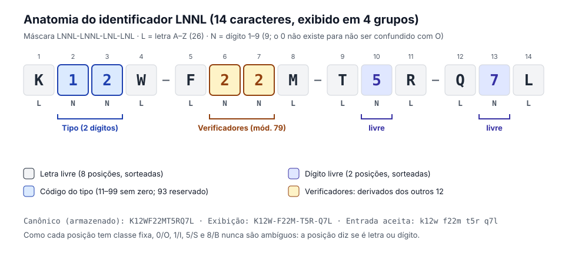
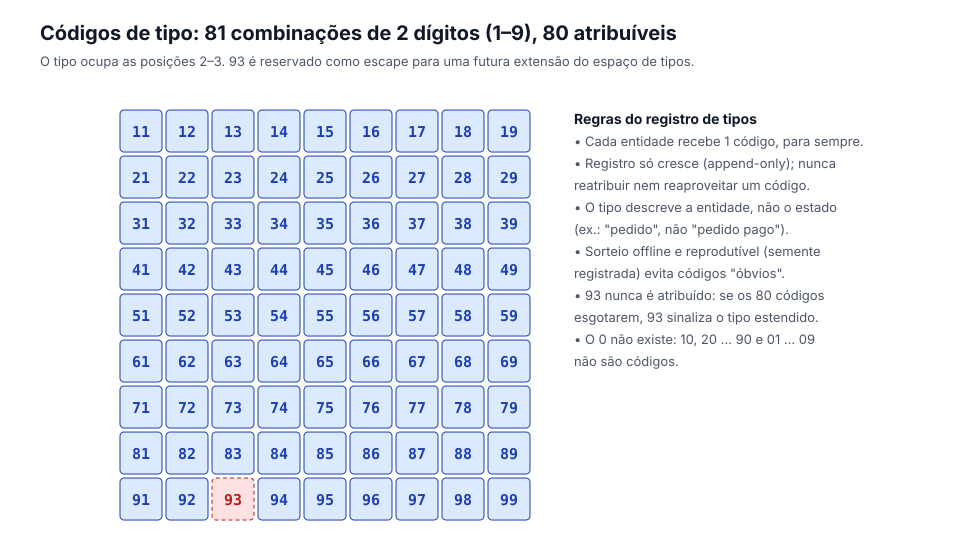
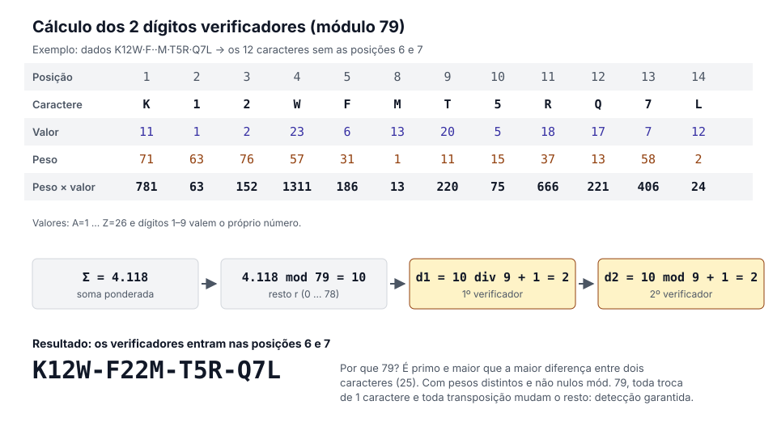
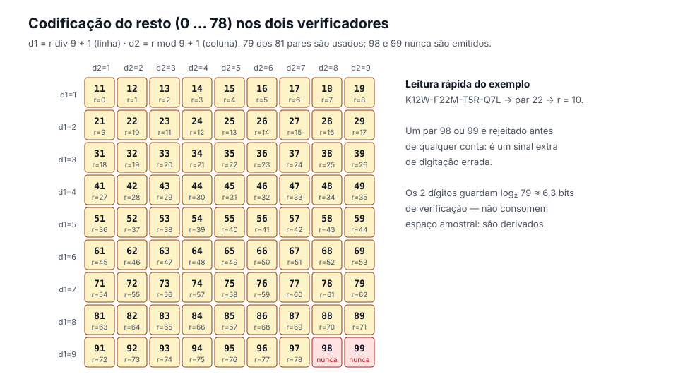
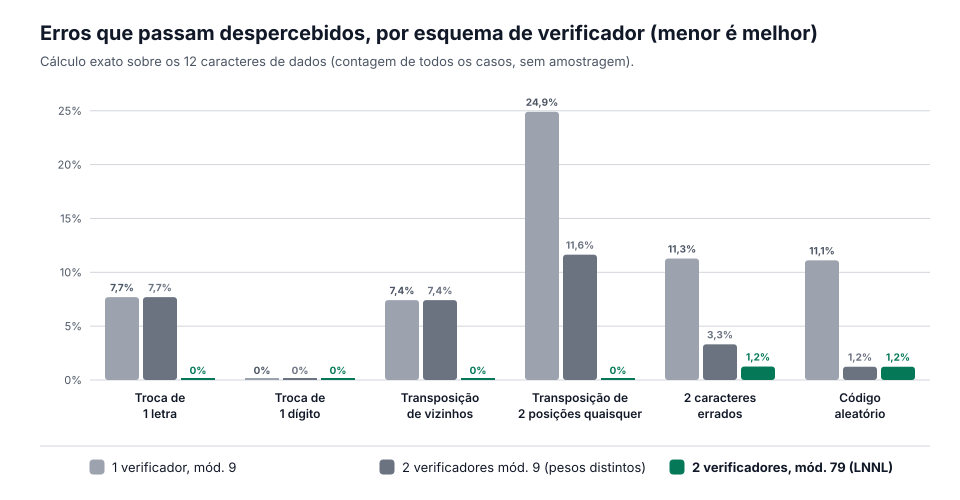
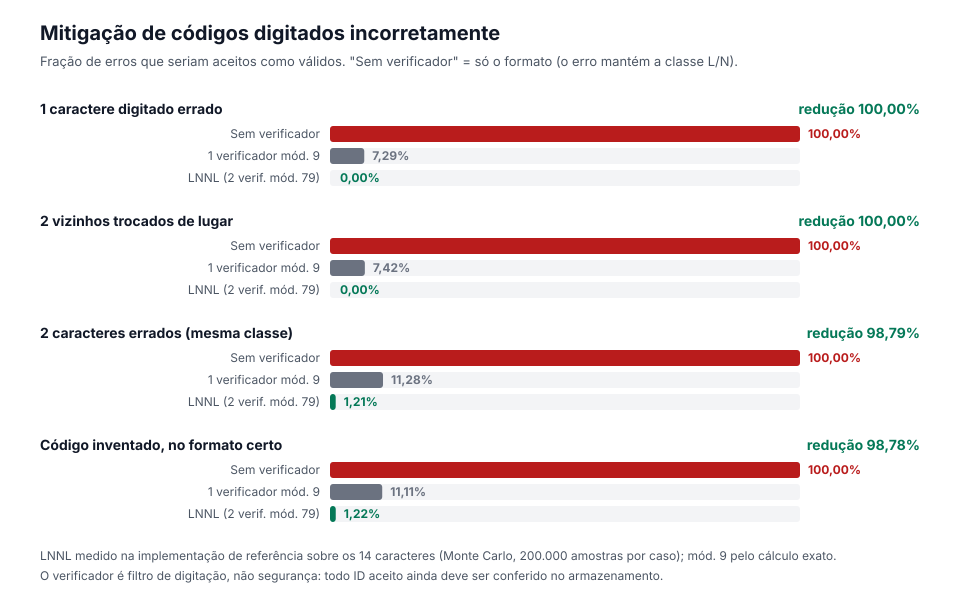
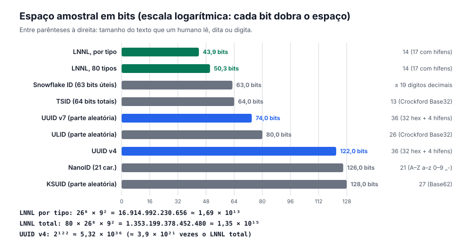
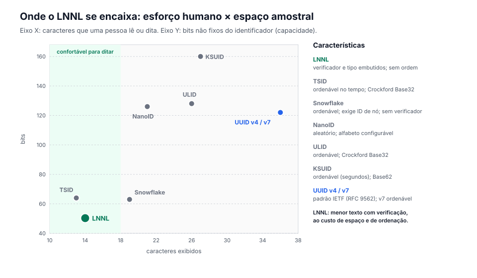

# LNNL: identificador interno legível por humanos com verificação módulo 79

```
Rascunho de especificação                                   LNNL-1 (rascunho 01)
Categoria: padrão informativo / interno                     15 de novembro de 2026
Substitui a nomenclatura: "ANNA-ANNA-ANA-ANA"
```

## Resumo

Este documento especifica o **LNNL**, um formato de identificador interno com 14 caracteres
alfanuméricos maiúsculos, exibido como `LNNL-LNNL-LNL-LNL` (exemplo: `K12W-F22M-T5R-Q7L`).
O identificador carrega um **código de tipo** de 2 dígitos e **2 dígitos verificadores**
calculados por soma ponderada **módulo 79**. Essa verificação detecta, com garantia
matemática, todo erro de um único caractere e toda transposição de dois caracteres. Também
rejeita cerca de 98,75% dos erros duplos antes de qualquer consulta ao armazenamento.

O LNNL **não substitui o UUID** como chave primária. Ele é um identificador **complementar**,
pensado para os momentos em que um ser humano lê, dita, digita ou confere o código: atendimento,
comprovantes, vouchers, conciliação e endpoints de consulta. Cabe a cada sistema decidir em
quais entidades, serviços e endpoints ele é exposto. O documento é independente de linguagem,
framework, banco de dados e projeto.

## Status deste documento

Rascunho para discussão, escrito no formato de uma RFC para facilitar uma eventual
padronização. As palavras-chave normativas seguem a seção 2. O algoritmo, os pesos e o módulo
descritos aqui estão **congelados**: uma alteração produziria um formato incompatível e
exigiria uma nova versão (seção 15).

## Sumário

1. [Introdução](#1-introdução)
2. [Convenções e terminologia](#2-convenções-e-terminologia)
3. [Nomenclatura: de ANNA para LNNL](#3-nomenclatura-de-anna-para-lnnl)
4. [Formato](#4-formato)
5. [Código de tipo e o código reservado 93](#5-código-de-tipo-e-o-código-reservado-93)
6. [Dígitos verificadores (módulo 79)](#6-dígitos-verificadores-módulo-79)
7. [Mitigação de erros de digitação](#7-mitigação-de-erros-de-digitação)
8. [Geração e unicidade](#8-geração-e-unicidade)
9. [Validação](#9-validação)
10. [Armazenamento, exibição e entrada](#10-armazenamento-exibição-e-entrada)
11. [Espaços amostrais comparados](#11-espaços-amostrais-comparados)
12. [Padrões existentes e onde o LNNL se encaixa](#12-padrões-existentes-e-onde-o-lnnl-se-encaixa)
13. [Quando usar e quando não usar](#13-quando-usar-e-quando-não-usar)
14. [Considerações de segurança e privacidade](#14-considerações-de-segurança-e-privacidade)
15. [Versionamento e interoperabilidade](#15-versionamento-e-interoperabilidade)
16. [Implementações de referência e vetores de teste](#16-implementações-de-referência-e-vetores-de-teste)
17. [Referências](#17-referências)
- [Apêndice A — Provas das garantias de detecção](#apêndice-a--provas-das-garantias-de-detecção)
- [Apêndice B — Histórico da decisão](#apêndice-b--histórico-da-decisão)
- [Apêndice C — Exemplo de uso em endpoint](#apêndice-c--exemplo-de-uso-em-endpoint)

---

## 1. Introdução

### 1.1 O problema

Sistemas modernos usam UUIDs como chave primária, e com razão: são gerados sem coordenação,
não revelam volume de negócio e praticamente não colidem. Mas um UUID tem **32 dígitos
hexadecimais** (36 caracteres com os hífens), como `3f2b8c1e-7a4d-4e9b-9c2f-1d6e5a8b0c47`.
Na prática, ninguém dita isso por telefone, confere de olho num comprovante impresso ou
digita sem errar. Um erro de digitação num UUID também não é detectável: o resultado é outro
UUID perfeitamente válido.

No extremo oposto, inteiros sequenciais (`#10423`) são fáceis de ditar. Em troca, permitem
enumeração (`#10424`, `#10425`…), revelam o volume de negócio, exigem um contador central e
também não detectam erros.

### 1.2 O meio-termo

O LNNL ocupa o espaço entre os dois:

| | UUID | LNNL | Inteiro sequencial |
| :-- | :-: | :-: | :-: |
| Caracteres que o humano lê | 32 (+4 hífens) | **14** (+3 hífens) | 5–10 |
| Detecta erro de digitação | não | **sim (mód. 79)** | não |
| Revela volume / permite enumerar por incremento | não | **não** | sim |
| Diz o tipo da entidade | não | **sim** | não |
| Geração sem coordenação central | sim | **sim** (com restrição única) | não |
| Espaço amostral | 2¹²² | 1,69 × 10¹³ por tipo | o contador |

São **14 caracteres contra 32**: menos da metade. A alternância fixa entre letras e dígitos
cria grupos curtos e pronunciáveis (`K12W` · `F22M` · `T5R` · `Q7L`), mais fáceis de reter na
memória de curto prazo do que blocos hexadecimais.

### 1.3 Objetivos e não objetivos

Objetivos:

- ser lido, ditado e digitado por humanos com pouco erro;
- detectar erros de transcrição **antes** de consultar o armazenamento;
- indicar o tipo da entidade só de olhar;
- não depender de linguagem, framework, banco ou projeto.

Não objetivos:

- **não** é chave primária nem substitui o UUID; os dois coexistem;
- **não** é segredo nem credencial (seção 14);
- **não** é ordenável no tempo; use um campo de data de criação para isso;
- **não** é adequado para bilhões de registros por tipo (seção 8.2).

---

## 2. Convenções e terminologia

As palavras **DEVE**, **NÃO DEVE**, **OBRIGATÓRIO**, **DEVERIA**, **NÃO DEVERIA**,
**RECOMENDADO**, **PODE** e **OPCIONAL** são interpretadas como em BCP 14
([RFC 2119], [RFC 8174]) quando aparecem em negrito e maiúsculas.

| Termo | Definição |
| :-- | :-- |
| **L** | Uma letra maiúscula de `A` a `Z` (26 símbolos). |
| **N** | Um dígito de `1` a `9` (9 símbolos; o `0` não pertence ao alfabeto). |
| **Forma canônica** | Os 14 caracteres sem separadores, em maiúsculas. É o que se armazena e compara. |
| **Forma de exibição** | A forma canônica com hífens após as posições 4, 8 e 11: `LNNL-LNNL-LNL-LNL`. |
| **Dados** | Os 12 caracteres que não são verificadores (posições 1–5 e 8–14), nessa ordem. |
| **Tipo** | O código de 2 dígitos nas posições 2–3, que identifica a entidade. |
| **Verificadores** | Os 2 dígitos nas posições 6–7, derivados dos dados. |
| **Registro de tipos** | A tabela, só de acréscimos, que associa cada entidade a um tipo. |

---

## 3. Nomenclatura: de ANNA para LNNL

A primeira versão deste formato chamava a máscara de `ANNA-ANNA-ANA-ANA`, com `A` de
"alfabético". A partir deste documento, o nome passa a ser **LNNL** (`LNNL-LNNL-LNL-LNL`):

- **L** = *letra* (maiúscula, `A`–`Z`);
- **N** = *número* (dígito, `1`–`9`).

O motivo é evitar ambiguidade: `A` também é um *valor* possível na posição (a letra A), e uma
máscara `ANNA` lida em voz alta se confunde com um identificador de verdade. `L` e `N` não
deixam dúvida sobre o que é classe e o que é conteúdo. O formato, o algoritmo e todos os
identificadores já emitidos **não mudam**: a troca é só de nome.

---

## 4. Formato

### 4.1 Alfabeto

- Letras: `ABCDEFGHIJKLMNOPQRSTUVWXYZ`, **somente maiúsculas**. Não há distinção entre
  maiúsculas e minúsculas, então o identificador atravessa sem perda planilhas, e-mail,
  bancos com *collation* que ignora o caso, URLs e buscas.
- Dígitos: `123456789`. **O zero não existe**, para não ser confundido com a letra `O`.

Como **cada posição tem classe fixa** (letra ou dígito), as confusões visuais clássicas
`O/0`, `I/1`, `S/5`, `B/8` e `Z/2` se resolvem pela posição: um `O` digitado onde a máscara
pede `N` é erro de formato, rejeitado antes de qualquer conta.

### 4.2 Disposição dos 14 caracteres



*Figura 1 — anatomia do identificador.*

| Posição | 1 | 2 | 3 | 4 | 5 | 6 | 7 | 8 | 9 | 10 | 11 | 12 | 13 | 14 |
| :-- | :-: | :-: | :-: | :-: | :-: | :-: | :-: | :-: | :-: | :-: | :-: | :-: | :-: | :-: |
| Classe | L | N | N | L | L | N | N | L | L | N | L | L | N | L |
| Papel | livre | **tipo** | **tipo** | livre | livre | **verif.** | **verif.** | livre | livre | livre | livre | livre | livre | livre |
| Exemplo | K | 1 | 2 | W | F | 2 | 2 | M | T | 5 | R | Q | 7 | L |

Resumo: **8 letras livres**, **2 dígitos livres** (posições 10 e 13), **2 dígitos de tipo**
(posições 2–3) e **2 dígitos verificadores** (posições 6–7).

O primeiro grupo começa pelo tipo (`L` + `NN` de tipo + `L`) e o segundo carrega os
verificadores (`L` + `NN` verificadores + `L`). Quem conhece o registro identifica a
entidade pelo primeiro grupo e quem confere o código encontra os verificadores no segundo.

### 4.3 Gramática (ABNF, [RFC 5234])

```abnf
lnnl-canonico = L tipo L L verif L L N L L N L
lnnl-exibicao = L tipo L "-" L verif L "-" L N L "-" L N L
tipo          = N N            ; 11–99 sem zero; "93" reservado (seção 5.3)
verif         = N N            ; derivado (seção 6); nunca "98" nem "99"
L             = %x41-5A        ; A–Z
N             = %x31-39        ; 1–9
```

### 4.4 Expressão regular da forma canônica

```
^[A-Z][1-9]{2}[A-Z]{2}[1-9]{2}[A-Z]{2}[1-9][A-Z]{2}[1-9][A-Z]$
```

Cada aplicação **PODE** especializar a expressão fixando o tipo, por exemplo `^[A-Z]22[A-Z]…$`
para pedidos.

---

## 5. Código de tipo e o código reservado 93

### 5.1 Espaço de tipos



*Figura 2 — os 81 códigos de 2 dígitos sem zero; 80 são atribuíveis.*

Com dois dígitos de 1 a 9 há **81 códigos** (11–19, 21–29, …, 91–99). Os números que contêm
zero (`10`, `20`, …, `90`, `01`–`09`) não existem. O código `93` é reservado, o que deixa
**80 tipos atribuíveis**: espaço de sobra para as entidades de um sistema típico (pedido,
cliente, ingresso, voucher, fatura, chamado…).

### 5.2 Registro de tipos

- Cada entidade **DEVE** receber exatamente um código, e esse código **NÃO DEVE** mudar.
- O registro **DEVE** ser só de acréscimos (*append-only*). Um código **NÃO DEVE** ser
  reatribuído nem reaproveitado, nem depois que a entidade deixar de existir.
- O tipo **DEVE** descrever a entidade, não o seu estado. Use "pedido", e não "pedido pago":
  um estado muda e o identificador não pode mudar junto.
- A atribuição **DEVERIA** ser sorteada offline, com a semente registrada, para que seja
  reprodutível e não gere códigos "óbvios" (como 11, 22, 33 em sequência) que sugiram
  ordem ou quantidade. Em tempo de execução nada é sorteado: o registro é uma constante.

### 5.3 O código 93: escape reservado

O código `93` **NÃO DEVE** ser atribuído a nenhuma entidade. Um validador LNNL-1 **DEVE**
rejeitar um identificador com tipo `93` (erro `TIPO_RESERVADO`), mesmo que os verificadores
estejam corretos.

O 93 é o **mecanismo de escape** para uma versão futura. Se os 80 códigos se esgotarem, ou se
surgir a necessidade de um subespaço especial, um identificador com tipo `93` indicará que o
tipo real está codificado em outra parte (por exemplo, nas posições livres seguintes). Ao
reservá-lo desde o início, todo identificador LNNL-1 continua inequívoco e nenhum
identificador já emitido precisa mudar quando a extensão existir.

---

## 6. Dígitos verificadores (módulo 79)

### 6.1 Valor de cada caractere

| Caractere | Valor |
| :-- | :-- |
| `A` … `Z` | 1 … 26 (`A`=1, `B`=2, …, `Z`=26) |
| `1` … `9` | 1 … 9 |

### 6.2 Pesos normativos

Os 12 caracteres de dados, na ordem das posições 1–5 e 8–14, são multiplicados por:

```
PESOS = (71, 63, 76, 57, 31, 1, 11, 15, 37, 13, 58, 2)
```

Esses valores **NÃO DEVEM** ser alterados: mudar um peso invalida todos os identificadores
emitidos. Para as garantias da seção 7 bastaria que os pesos fossem **distintos e não nulos
módulo 79**. Estes foram sorteados uma vez e congelados; mais aleatoriedade não melhoraria
nada.

### 6.3 Algoritmo

```
entrada: dados[1..12]           (posições 1–5 e 8–14 do identificador)
S  ← Σ PESOS[i] × valor(dados[i])     para i = 1..12
r  ← S mod 79                         (0 ≤ r ≤ 78)
d1 ← ⌊r / 9⌋ + 1                      (1 ≤ d1 ≤ 9)
d2 ← (r mod 9) + 1                    (1 ≤ d2 ≤ 9)
identificador ← dados[1..5] ‖ d1 ‖ d2 ‖ dados[6..12]
```

### 6.4 Exemplo completo



*Figura 3 — cálculo passo a passo para os dados `K12WFMT5RQ7L`.*

A soma ponderada é **4.118**, e **4.118 mod 79 = 10**. Logo `d1 = 10 div 9 + 1 = 2` e
`d2 = 10 mod 9 + 1 = 2`, e o identificador final é **`K12W-F22M-T5R-Q7L`**.

### 6.5 Codificação do resto nos dois dígitos



*Figura 4 — os 79 restos ocupam 79 dos 81 pares possíveis.*

Os 79 restos possíveis (0 a 78) são escritos em base 9 com os dígitos deslocados para 1–9.
Os pares `98` e `99` **nunca** são emitidos, então um verificador `98` ou `99` já é prova de
erro, sem conta nenhuma. Os dois dígitos carregam log₂ 79 ≈ 6,3 bits de verificação e **não
consomem espaço amostral**, porque são derivados dos dados.

### 6.6 Por que exatamente 79

1. **É primo.** Num módulo primo, qualquer valor não nulo tem inverso. Essa é a base das
   garantias do Apêndice A.
2. **É maior que 25**, a maior diferença possível entre dois caracteres (`Z`−`A`). Assim
   nenhuma troca de caractere "dá a volta" no módulo e some.
3. **É o maior primo que cabe em dois dígitos de 1 a 9.** Dois dígitos sem zero oferecem
   9 × 9 = 81 combinações, e o maior primo ≤ 81 é 79. Um módulo maior, como o 97 do IBAN
   (ISO 7064 MOD 97-10), não caberia sem o dígito 0. Um módulo menor, como o 9, perde
   detecção (seção 7).

O 79 é, portanto, o **ótimo** para dois verificadores no alfabeto 1–9. A mesma ideia de dois
dígitos com um módulo primo próximo de 100 é usada há décadas no IBAN ([ISO 7064]); o LNNL a
adapta a um alfabeto sem zero.

---

## 7. Mitigação de erros de digitação

### 7.1 Garantias (provadas no Apêndice A)

Para qualquer identificador LNNL válido:

- **toda troca de um caractere é detectada** (100%): pelo formato, se a troca muda a classe
  L/N, ou pelos verificadores, se mantém a classe;
- **toda transposição de dois caracteres é detectada** (100%), sejam eles vizinhos ou não;
- um **erro duplo** (dois caracteres trocados) passa despercebido com probabilidade
  ≈ 1/79 ≈ 1,25%. Esse é o piso teórico para dois dígitos verificadores;
- um **código inventado** no formato certo passa com probabilidade 1/81 ≈ 1,23%.

### 7.2 Comparação com o módulo 9



*Figura 5 — taxa de erros que passam despercebidos (cálculo exato, sem amostragem; gerado
por `ferramentas/analise_deteccao.py`).*

| Esquema | Troca de 1 letra | Troca de 1 dígito | Transposição de vizinhos | Transposição de 2 posições quaisquer | 2 caracteres errados | Código aleatório |
| :-- | --: | --: | --: | --: | --: | --: |
| 1 verificador, mód. 9 | 7,69% | 0,00% | 7,42% | 24,90% | 11,28% | 11,11% |
| 2 verificadores mód. 9 (pesos distintos) | 7,69% | 0,00% | 7,42% | 11,64% | 3,31% | 1,23% |
| **2 verificadores, mód. 79 (LNNL)** | **0,00%** | **0,00%** | **0,00%** | **0,00%** | **1,25%** | **1,23%** |

**Por que o módulo 9 falha.** As letras valem de 1 a 26. Letras cujo valor tem o mesmo resto
na divisão por 9 (`A`/`J`/`S`, `B`/`K`/`T`, `C`/`L`/`U` e assim por diante) produzem a mesma soma
qualquer que seja o peso. Das 650 trocas possíveis de uma letra por outra, **50** (7,69%) não
alteram o verificador. Um segundo dígito módulo 9 herda a mesma falha. **O problema está no
módulo, não nos pesos**, e trocá-lo por 79 elimina essa classe de erro inteira.

### 7.3 Redução percentual



*Figura 6 — fração de códigos errados que seriam aceitos, sem verificador, com mód. 9 e com
LNNL. LNNL medido na implementação de referência sobre os 14 caracteres (Monte Carlo,
200.000 amostras por caso).*

| Erro humano | Sem verificador | 1 verif. mód. 9 | **LNNL** | **Redução com LNNL** |
| :-- | --: | --: | --: | --: |
| 1 caractere errado (mesma classe) | 100% | 7,29% | **0%** | **100%** |
| 2 vizinhos trocados de lugar | 100% | 7,42% | **0%** | **100%** |
| 2 caracteres errados (mesma classe) | 100% | 11,28% | **1,21%** | **98,79%** |
| Código inventado, no formato certo | 100% | 11,11% | **1,22%** | **98,78%** |

Considerando também os erros que mudam a classe L/N (pegos já pelo formato), a contraprova
mediu **0% de aceitação para um caractere errado e 0,33% para dois** sobre os 14 caracteres.

> O verificador é um **filtro contra erros de transcrição**, não uma proteção. Todo
> identificador aceito pelo validador **DEVE** ainda ser buscado no armazenamento, com os
> filtros de autorização e de *tenant* aplicáveis (seção 14).

### 7.4 Sugestão de correção (opcional)

Como todo erro de um caractere é detectado, um identificador com **um** erro sempre tem o
original entre os seus "vizinhos válidos": os identificadores válidos a um caractere de
distância. Um sistema de atendimento **PODE** listar esses candidatos e conferi-los no
armazenamento para ajudar o operador. No exemplo, `K12W-F22M-T5R-Q7M` tem quatro vizinhos
válidos, e o original `…Q7L` está entre eles. O sistema **NÃO DEVE** corrigir
automaticamente, porque pode haver mais de um candidato.

---

## 8. Geração e unicidade

### 8.1 Regras

- As posições livres **DEVEM** ser sorteadas com um gerador criptograficamente seguro (CSPRNG:
  `secrets` em Python, `crypto.getRandomValues` em JavaScript, `/dev/urandom`) e com
  distribuição uniforme, sem viés de módulo.
- A unicidade **DEVE** ser garantida pelo armazenamento, com uma restrição `UNIQUE`. O gravador
  **DEVE** inserir e, em caso de violação, gerar outro identificador e tentar de novo (limite
  sugerido: 5 tentativas), dentro de transação. **NÃO DEVE** consultar a existência antes e
  inserir depois, porque isso cria uma condição de corrida.
- O identificador **DEVE** ser imutável depois de emitido e **NÃO DEVE** ser reaproveitado,
  nem depois de o registro ser excluído.
- O formato **DEVERIA** ser imposto também no banco, com `CHECK` (seção 10.1), porque
  validações de aplicação não cobrem importações nem gravações diretas.

### 8.2 Colisões e capacidade

Por tipo existem N = 26⁸ × 9² = **16.914.992.230.656** identificadores (≈ 1,69 × 10¹³,
≈ 43,9 bits). Com sorteio uniforme:

| Registros existentes no tipo | Chance de um novo sorteio colidir | Chance de ter havido ao menos uma colisão |
| --: | --: | --: |
| 100.000 | 5,9 × 10⁻⁹ | 0,03% |
| 1.000.000 | 5,9 × 10⁻⁸ | 2,9% |
| 10.000.000 | 5,9 × 10⁻⁷ | 94,8% |

A colisão em si não é um problema, porque a restrição única e a nova tentativa resolvem.
O que importa é a chance de *cada inserção* precisar de uma segunda tentativa, que continua
desprezível na casa das dezenas de milhões. A partir de ~50% de ocupação "de aniversário"
(≈ 4,8 milhões de registros por tipo), haverá colisões ocasionais e tratadas. **Para tipos
com previsão de bilhões de registros, o LNNL não é a escolha certa** (seção 13).

---

## 9. Validação

### 9.1 Ordem normativa

O validador **DEVE** normalizar a entrada (seção 10.3) e aplicar as verificações nesta ordem,
reportando o primeiro erro encontrado:

| # | Verificação | Código de erro |
| :-: | :-- | :-- |
| 1 | 14 caracteres após a normalização | `TAMANHO_INVALIDO` |
| 2 | Expressão regular da seção 4.4 | `FORMATO_INVALIDO` |
| 3 | Tipo diferente de `93` | `TIPO_RESERVADO` |
| 4 | Tipo igual ao esperado pelo contexto (se houver) | `TIPO_INCOMPATIVEL` |
| 5 | Verificadores iguais aos recalculados | `VERIFICADOR_INVALIDO` |

A verificação 4 transforma o tipo em uma defesa extra: num endpoint de pedidos, um
identificador de cliente é recusado antes da consulta, mesmo sendo válido.

### 9.2 Custo

A validação é O(1): 12 multiplicações, uma soma e um resto. Ela pode ser repetida no
navegador, no aplicativo e no servidor. Validar no cliente melhora a experiência
(o campo acusa o erro enquanto a pessoa digita), mas **não dispensa** a validação no servidor.

---

## 10. Armazenamento, exibição e entrada

### 10.1 Armazenamento

- Armazene **somente a forma canônica**: `CHAR(14)` ASCII, sem hífens.
- Use índice único. Em bancos com *collation* que ignora maiúsculas e minúsculas, o formato
  continua seguro (é todo maiúsculo), mas **DEVERIA** usar *collation* binária para evitar
  comparações caras.
- O arquivo [`referencia/sql/lnnl.sql`](referencia/sql/lnnl.sql) traz restrições `CHECK`
  para PostgreSQL (incluindo uma função que recalcula os verificadores), MySQL/MariaDB e
  SQLite.

### 10.2 Exibição

- Mostre a forma de exibição `LNNL-LNNL-LNL-LNL` (grupos 4-4-3-3), em fonte monoespaçada.
- Ofereça um botão de copiar e use `user-select: all`: o clique duplo para no hífen.
- Ao ditar, leia por grupos. Um alfabeto fonético (OTAN/ICAO, ou o habitual do idioma)
  **PODE** ser oferecido ao operador.

### 10.3 Entrada e normalização

A entrada **DEVE** aceitar minúsculas, hífens, espaços e outros separadores, e
**DEVE** normalizar para maiúsculas e somente `A`–`Z`/`0`–`9` antes de validar. O `0` é
mantido na normalização justamente para ser rejeitado como erro de formato, e não
silenciosamente descartado. Exemplo: ` k12w f22m-t5r q7l ` normaliza para `K12WF22MT5RQ7L`.

---

## 11. Espaços amostrais comparados



*Figura 7 — bits do espaço amostral (escala logarítmica) e tamanho do texto exibido.*

| Formato | Espaço | Bits | Texto exibido |
| :-- | :-- | --: | :-- |
| **LNNL, por tipo** | 26⁸ × 9² = 16.914.992.230.656 | **43,9** | 14 (17 com hífens) |
| **LNNL, 80 tipos** | 80 × 26⁸ × 9² = 1.353.199.378.452.480 | **50,3** | 14 (17 com hífens) |
| LNNL, grade bruta de 14 posições (incluindo verificadores) | 26⁸ × 9⁶ ≈ 1,11 × 10¹⁷ | 56,6 | — |
| Snowflake ID | 2⁶³ (41 bits de tempo + 10 de nó + 12 de sequência) | 63 | até 19 dígitos decimais |
| UUID v7 | 48 bits de tempo + 74 aleatórios | 122 | 36 |
| **UUID v4** | 2¹²² ≈ 5,32 × 10³⁶ | **122** | 36 (32 hexadecimais + 4 hífens) |

**Leitura.** O UUID v4 tem cerca de **3,9 × 10²¹ vezes** mais combinações que todo o
espaço LNNL somado. Esse é o preço de caber em 14 caracteres. Por isso a divisão de papéis:

- o **UUID** continua sendo a identidade técnica, sem coordenação, para sempre e em qualquer
  escala: chaves primárias, chaves estrangeiras, replicação, integrações máquina a máquina;
- o **LNNL** é a identidade **humana**: grande o bastante para dezenas de milhões de
  registros por tipo, pequena o bastante para ditar, e protegida contra erros de transcrição,
  que o UUID não detecta.

O LNNL fica, de propósito, no **meio-termo**: muito acima de um contador (sem enumeração,
sem vazamento de volume, com tipo e verificação) e muito abaixo de um UUID em espaço (mas
com menos da metade dos caracteres).

---

## 12. Padrões existentes e onde o LNNL se encaixa

### 12.1 Identificadores únicos

| Padrão | Estrutura | Tamanho exibido | Ordenável no tempo | Verificador | Coordenação | Observações |
| :-- | :-- | :-- | :-: | :-: | :-- | :-- |
| **UUID v4** ([RFC 9562]) | 122 bits aleatórios | 36 | não | não | nenhuma | Padrão IETF universal; longo para humanos; fragmenta índices B-tree. |
| **UUID v7** ([RFC 9562]) | 48 bits de tempo (ms) + 74 aleatórios | 36 | sim | não | nenhuma | Bom para índices; expõe o instante de criação. |
| UUID v1/v6 | tempo + relógio + nó (MAC) | 36 | v6 sim | não | nenhuma | Pode expor o MAC; legado. |
| **Snowflake ID** (Twitter, 2010) | 41 bits de tempo + 10 de nó + 12 de sequência | ≤ 19 dígitos | sim | não | ID de nó único | 64 bits (cabe em `BIGINT`); 4.096 IDs/ms/nó; ~69 anos por época; exige gestão de nós e relógio. |
| Sonyflake / Instagram ID | variações do Snowflake | ≤ 19 dígitos | sim | não | ID de nó | Trocam resolução de tempo por mais nós. |
| **ULID** | 48 bits de tempo + 80 aleatórios | 26 (Crockford Base32) | sim | não | nenhuma | Compatível com 128 bits do UUID; ordenação lexicográfica. |
| **KSUID** (Segment) | 32 bits de tempo (s) + 128 aleatórios | 27 (Base62) | sim | não | nenhuma | 160 bits; sensível a maiúsculas e minúsculas. |
| **TSID** | 42 bits de tempo + 22 de nó/aleatório | 13 (Crockford Base32) | sim | não | opcional | 64 bits; curto, mas com espaço aleatório pequeno por milissegundo. |
| ObjectId (MongoDB) / xid | 32 bits de tempo + 40 aleatórios + 24 de contador | 24 hex / 20 | sim | não | nenhuma | 96 bits. |
| **NanoID** | aleatório, alfabeto configurável | 21 (padrão) | não | não | nenhuma | 126 bits por padrão; usa `_` e `-` e é sensível a maiúsculas e minúsculas. |
| CUID2 | hash com entropia e contador | 24 (padrão) | não | não | nenhuma | Pensado para não vazar informação; não ordenável. |
| Sqids (ex-Hashids) | codifica um inteiro | variável | — | não | o inteiro | Ofusca, não protege: é reversível. |
| **LNNL** (este documento) | tipo + 10 posições aleatórias + 2 verificadores | **14 (17)** | não | **sim (mód. 79)** | nenhuma (restrição única) | Feito para humanos; tipo embutido; ~44 bits por tipo. |

### 12.2 Sistemas de dígito verificador

| Sistema | Onde é usado | Detecta toda troca de 1 símbolo | Detecta toda transposição de vizinhos | Observação |
| :-- | :-- | :-: | :-: | :-- |
| Luhn (mód. 10) | cartões (ISO/IEC 7812) | sim | não (`09`↔`90`) | Só dígitos. |
| ISBN-13 / EAN-13 (mód. 10, pesos 1 e 3) | livros, código de barras | sim | não (diferença 5) | Só dígitos. |
| Verhoeff | diversos | sim | sim | Grupo diedral D5; só dígitos. |
| Damm | diversos | sim | sim | Quasigrupo; só dígitos. |
| Mód. 11 (CPF, CNPJ, ISBN-10) | documentos | sim | sim | Precisa de um símbolo extra (`X`) ou de regra para o resto 10. |
| ISO 7064 MOD 97-10 | IBAN | sim | sim | 2 dígitos; letras convertidas em 10–35. |
| ISO 7064 MOD 37-36 / Crockford Base32 (mód. 37) | identificadores alfanuméricos | sim | sim | 1 símbolo extra fora do alfabeto. |
| **LNNL (mód. 79, 2 dígitos 1–9)** | este documento | **sim** | **sim, e qualquer transposição** | Letras e dígitos; dois verificadores dentro do próprio alfabeto. |

O LNNL segue a mesma família do IBAN (módulo primo, dois dígitos), ajustada a um alfabeto
**sem zero** e **sem símbolos extras**.

### 12.3 UUID × Snowflake × LNNL

| Critério | UUID (v4/v7) | Snowflake | **LNNL** |
| :-- | :-- | :-- | :-- |
| Tamanho | 128 bits; 36 caracteres | 64 bits; até 19 dígitos | ~50 bits úteis; **14 caracteres** |
| Coordenação | nenhuma | ID de nó único por gerador e relógio confiável | nenhuma (restrição única no armazenamento) |
| Ordenação | v4 não; v7 sim | sim (tempo) | **não** (use a data de criação) |
| Vaza informação | v7: instante de criação | instante, nó e volume aproximado | **nada** além do tipo |
| Colisão | desprezível em qualquer escala | nenhuma, se os nós forem únicos | tratada por nova tentativa; adequado até dezenas de milhões por tipo |
| Detecção de erro humano | nenhuma | nenhuma | **100% de 1 erro e de transposições; 98,75% de 2 erros** |
| Tipo da entidade no identificador | não | não | **sim** |
| Ditar por telefone | inviável | difícil (19 dígitos sem verificação) | **viável** (4 grupos curtos) |
| Uso como chave primária | sim (o padrão) | sim (`BIGINT`) | **não recomendado** |



*Figura 8 — esforço humano (caracteres) × espaço amostral (bits).*

**Vantagens do LNNL**

- Menos que a metade dos caracteres de um UUID e menos que um Snowflake em decimal.
- Única opção da tabela 12.1 com **detecção de erro de transcrição** embutida.
- **Tipo embutido**: o identificador diz o que é, e um endpoint recusa o tipo errado.
- Não vaza tempo, nó nem volume, ao contrário do Snowflake, do UUID v7, do ULID e do KSUID.
- Sem coordenação de nós nem dependência de relógio, ao contrário do Snowflake.
- Imune a caixa (todo maiúsculo) e sem `0`: atravessa planilhas, e-mail e voz.
- Blocos de letras com **no máximo 2 letras seguidas**, o que reduz muito a chance de
  formar palavras ofensivas.

**Desvantagens do LNNL**

- Espaço amostral muito menor: não serve como identidade universal nem para bilhões de
  registros por tipo.
- Não é ordenável no tempo: precisa de um campo de data de criação.
- Exige restrição única e nova tentativa na gravação (o UUID dispensa as duas).
- Não é padrão de mercado: integrações externas continuam usando o UUID.
- 80 tipos por espaço (com extensão futura prevista pelo código 93).

---

## 13. Quando usar e quando não usar

**Use o LNNL** (a critério do desenvolvedor, por entidade e por endpoint) quando um humano
participa da transmissão do identificador:

- atendimento e suporte ("qual o código do seu pedido?");
- comprovantes, vouchers, ingressos e protocolos impressos ou enviados por mensagem;
- conciliação manual, auditoria e logs consultados por pessoas;
- endpoints de **consulta** em que o cliente informa o código, como
  `GET /pedidos/{id_interno}` (Apêndice C).

**Não use o LNNL** como:

- chave primária ou estrangeira (use o UUID);
- token de acesso, senha, segredo ou prova de posse (seção 14);
- critério de ordenação;
- identificador de tipos com volume esperado na casa dos bilhões.

Os dois identificadores **coexistem** na mesma linha: o UUID é a identidade técnica e o LNNL
a identidade humana. Cada sistema **PODE** escolher, por entidade, se o LNNL é exibido na
interface ou fica restrito a APIs autorizadas.

---

## 14. Considerações de segurança e privacidade

- **Não é segredo.** Conhecer um LNNL **NÃO DEVE** conceder acesso a nada. Toda consulta
  **DEVE** aplicar autenticação, autorização e, em sistemas multi-inquilino, o filtro de
  *tenant*.
- **Enumeração.** Com M registros num tipo, um palpite aleatório no formato certo acerta um
  registro existente com probabilidade M / 1,69 × 10¹³ (com 1 milhão de registros, ≈ 6 × 10⁻⁸
  por tentativa). Os verificadores eliminam 98,8% dos palpites antes do armazenamento, mas um
  atacante pode calculá-los, já que o algoritmo é público. Endpoints de consulta **DEVEM** ter
  limite de requisições.
- **Sem vazamento de informação.** O LNNL é aleatório: não revela o instante de criação, a
  ordem, o volume nem o servidor que o gerou. A única informação exposta é o tipo da
  entidade.
- **Sem dados pessoais.** O identificador **NÃO DEVE** ser derivado de dados pessoais (CPF,
  e-mail, telefone).
- **Respostas uniformes.** Para não ajudar a enumeração, um endpoint **DEVERIA** responder
  da mesma forma a "verificador inválido" e "não encontrado" quando o chamador não for
  autorizado.

---

## 15. Versionamento e interoperabilidade

- Este documento define o **LNNL-1**. O alfabeto, a disposição, os pesos, o módulo 79 e a
  regra do tipo 93 estão congelados.
- Qualquer mudança nesses elementos **DEVE** gerar uma nova versão (LNNL-2, …) com
  identificadores reconhecidamente distintos. O código de tipo `93` é o mecanismo previsto
  para isso.
- Implementações **DEVEM** passar em todos os vetores de [`vetores-teste.json`](vetores-teste.json).

---

## 16. Implementações de referência e vetores de teste

| Arquivo | Conteúdo |
| :-- | :-- |
| [`referencia/python/lnnl.py`](referencia/python/lnnl.py) | Implementação em Python, só com a biblioteca padrão. |
| [`referencia/python/test_lnnl.py`](referencia/python/test_lnnl.py) | Testes, incluindo verificações exaustivas de troca e de transposição. |
| [`referencia/javascript/lnnl.mjs`](referencia/javascript/lnnl.mjs) | Implementação em JavaScript (ES2020) para Node e navegador. |
| [`referencia/javascript/lnnl.test.mjs`](referencia/javascript/lnnl.test.mjs) | Testes com `node --test`. |
| [`referencia/sql/lnnl.sql`](referencia/sql/lnnl.sql) | Restrições para PostgreSQL, MySQL/MariaDB e SQLite. |
| [`vetores-teste.json`](vetores-teste.json) | 43 identificadores válidos (incluindo os restos extremos 0 e 78) e 11 inválidos com o erro esperado. |
| [`ferramentas/analise_deteccao.py`](ferramentas/analise_deteccao.py) | Cálculo exato das taxas de detecção e contraprova Monte Carlo. |
| [`ferramentas/gerar_figuras.py`](ferramentas/gerar_figuras.py) | Gera as figuras deste documento a partir da análise. |

---

## 17. Referências

**Normativas**

- [RFC 2119] Bradner, S. *Key words for use in RFCs to Indicate Requirement Levels*. BCP 14, 1997.
- [RFC 8174] Leiba, B. *Ambiguity of Uppercase vs Lowercase in RFC 2119 Key Words*. BCP 14, 2017.
- [RFC 5234] Crocker, D.; Overell, P. *Augmented BNF for Syntax Specifications: ABNF*. 2008.

**Informativas**

- [RFC 9562] Davis, K.; Peabody, B.; Leach, P. *Universally Unique IDentifiers (UUIDs)*. 2024 (substitui a RFC 4122).
- [ISO 7064] ISO/IEC 7064:2003. *Information technology — Security techniques — Check character systems*.
- ISO 13616. *Financial services — International bank account number (IBAN)*.
- ISO/IEC 7812. *Identification cards — Identification of issuers* (algoritmo de Luhn).
- Twitter Engineering. *Announcing Snowflake*. 2010.
- ULID Specification. github.com/ulid/spec.
- Segment. *KSUID: K-Sortable Unique IDentifier*. github.com/segmentio/ksuid.
- Crockford, D. *Base32 Encoding*. crockford.com/base32.html.
- Verhoeff, J. *Error Detecting Decimal Codes*. Mathematical Centre Tracts 29, 1969.
- Damm, H. M. *Total anti-symmetrische Quasigruppen*. Tese, Universidade de Marburg, 2004.

[RFC 2119]: https://www.rfc-editor.org/rfc/rfc2119
[RFC 8174]: https://www.rfc-editor.org/rfc/rfc8174
[RFC 5234]: https://www.rfc-editor.org/rfc/rfc5234
[RFC 9562]: https://www.rfc-editor.org/rfc/rfc9562
[ISO 7064]: https://www.iso.org/standard/31531.html

---

## Apêndice A — Provas das garantias de detecção

Seja `S = Σ wᵢ·vᵢ (mod 79)`, com pesos `wᵢ` distintos e não nulos módulo 79 e valores
`vᵢ ∈ [1, 26]`.

**A.1 Troca de um caractere de dados.** Trocar `vᵢ` por `v'ᵢ ≠ vᵢ` muda a soma em
`wᵢ·(v'ᵢ − vᵢ)`. Como 79 é primo, `wᵢ ≢ 0` e `0 < |v'ᵢ − vᵢ| ≤ 25 < 79`, o produto é
`≢ 0 (mod 79)`. O resto muda e o erro é detectado. ∎

**A.2 Troca de um verificador.** O par `(d1, d2)` codifica `r` de forma injetiva. Trocar
um dígito produz outro par, que codifica outro `r'` (ou `98`/`99`, nunca emitidos), diferente
do recalculado. ∎

**A.3 Transposição de dois caracteres de dados** (posições `i ≠ j`, valores `a ≠ b`). A soma
muda em `wᵢ·(b − a) + wⱼ·(a − b) = (wᵢ − wⱼ)·(b − a)`. Os pesos são distintos (`wᵢ − wⱼ ≢ 0`)
e `0 < |b − a| ≤ 25`. Como 79 é primo, o produto é `≢ 0`. ∎

Se a transposição mistura classes (letra com dígito), quem detecta é o formato.

**A.3b Transposição entre um verificador e um dígito de dados** (posição `p`, peso `w`, dígito
`x ≠ d`). Com `r = 9(d1 − 1) + (d2 − 1)`:

- trocar `d1` por `x` leva o resto codificado a `r + 9(x − d1)`, enquanto a soma passa a
  `r + w(d1 − x)`. Coincidem só se `(x − d1)(9 + w) ≡ 0`, ou seja, `w ≡ −9 ≡ 70 (mod 79)`;
- trocar `d2` por `x` leva a `r + (x − d2)` contra `r + w(d2 − x)`. Coincidem só se
  `w ≡ −1 ≡ 78 (mod 79)`.

Nenhum dos pesos normativos é 70 ou 78, então essas transposições também são sempre
detectadas. A enumeração exaustiva (79 restos × 2 verificadores × 4 posições de dígito × 8
valores) confirma: 0 falhas. ∎

**A.4 Erro duplo.** A soma muda em `wᵢΔᵢ + wⱼΔⱼ`, que pode ser `≡ 0`. Para valores
aleatórios, isso acontece com probabilidade ≈ 1/79. Esse é o limite inferior para qualquer
verificação de 2 dígitos sobre 79 classes de resto. O valor exato sobre todos os casos é
1,2495%.

**A.5 Por que pesos aleatórios não salvam o módulo 9.** Para letras com `vᵢ ≡ v'ᵢ (mod 9)`,
`wᵢ·(v'ᵢ − vᵢ) ≡ 0 (mod 9)` para **todo** peso `wᵢ`. São 50 das 650 trocas ordenadas entre
letras (7,69%), qualquer que seja a escolha dos pesos.

---

## Apêndice B — Histórico da decisão

1. **IDs por caixa** (`ABCDEFGH`, `abcdefgh`, `AbCdEfGh`, `aBcDeFgH`): o tipo era dado por
   maiúsculas e minúsculas, e qualquer camada que ignore o caso (*collation*, planilhas,
   e-mail, busca) fundia os tipos. Descartado.
2. **`NNNN-AAAA-AAAA`** com o tipo no primeiro dígito: resolveu o problema de caixa, mas
   limitava a 9 tipos e propunha um verificador módulo 9.
3. **A simulação revelou a falha do módulo 9** (seção 7.2). Pesos mais aleatórios não ajudaram:
   o problema era o módulo.
4. **`ANNA-ANNA-ANA-ANA` com dois verificadores módulo 79**: venceu por combinar 14
   caracteres, tipo de 2 dígitos (80 tipos), verificação com garantias matemáticas e grupos
   curtos alternando letra e dígito. O espaço amostral por tipo ficou igual ao da proposta
   anterior, porque os verificadores são derivados.
5. **Este documento** renomeia a máscara para **LNNL** e a especifica de forma independente
   de projeto.

---

## Apêndice C — Exemplo de uso em endpoint

```http
GET /api/pedidos/K22W-F92M-T5R-Q7L HTTP/1.1
Authorization: Bearer …
```

Processamento recomendado:

1. Normalizar: `K22WF92MT5RQ7L`.
2. Validar com `tipo_esperado = "22"` (pedido). Se falhar, responder `404` com corpo
   uniforme, sem chegar ao banco.
3. Consultar `WHERE id_interno = :id AND tenant_id = :tenant` e aplicar a autorização.
4. Responder com o UUID interno **e** o LNNL formatado. O UUID segue para integrações e o
   LNNL para pessoas.

```json
{
  "id": "3f2b8c1e-7a4d-4e9b-9c2f-1d6e5a8b0c47",
  "id_interno": "K22W-F92M-T5R-Q7L",
  "status": "pago"
}
```
